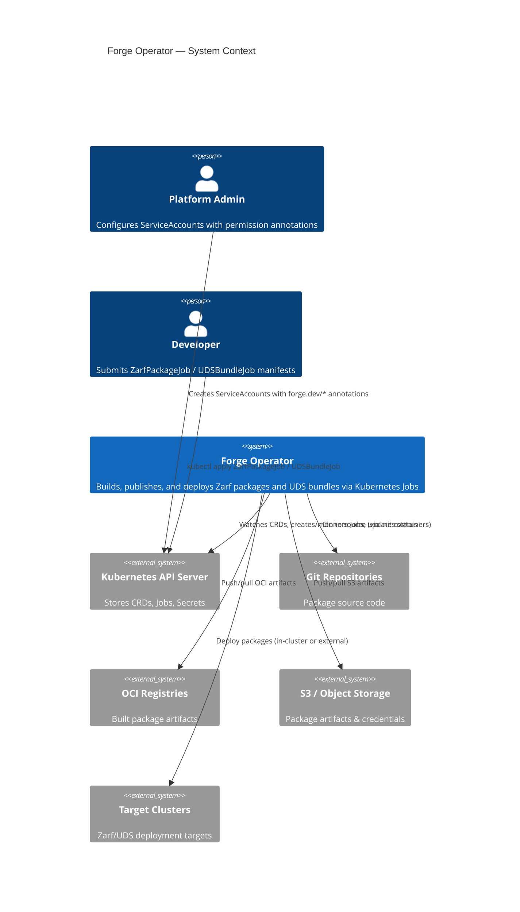
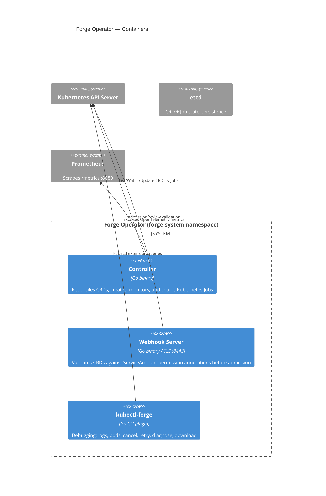
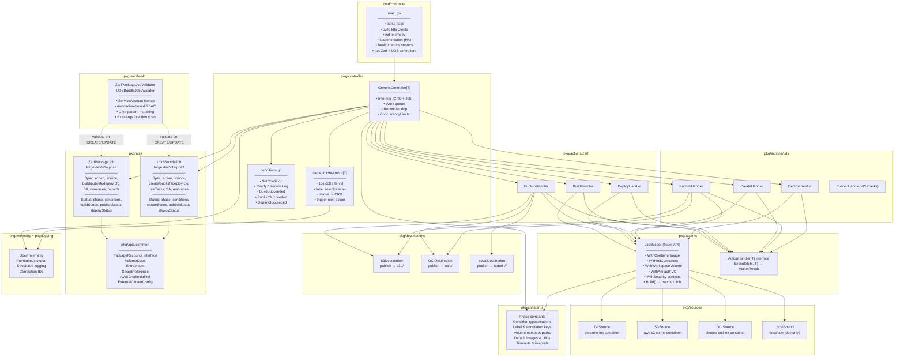
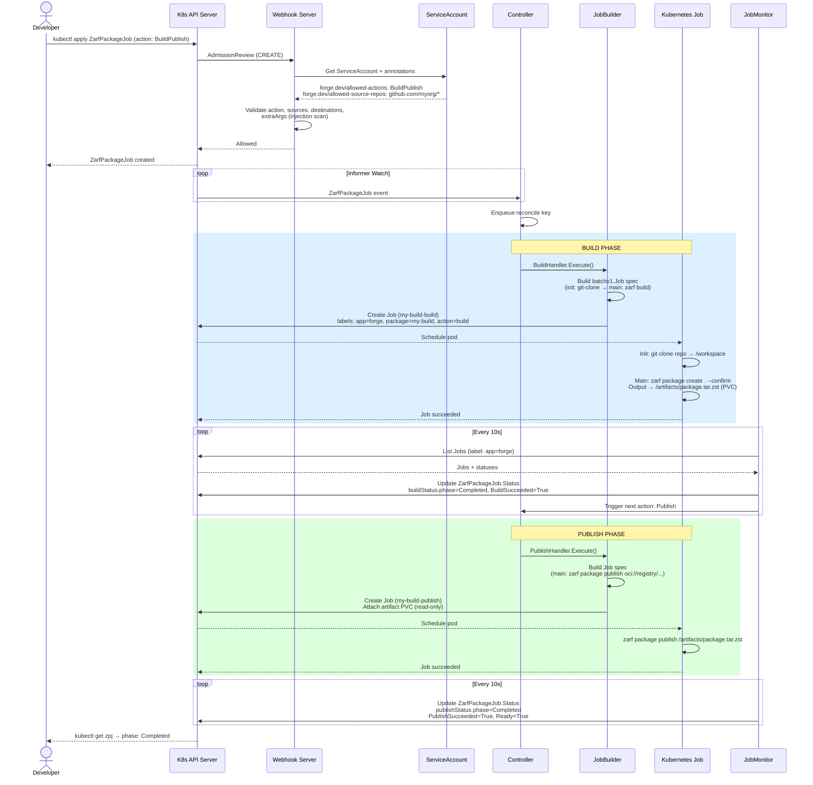
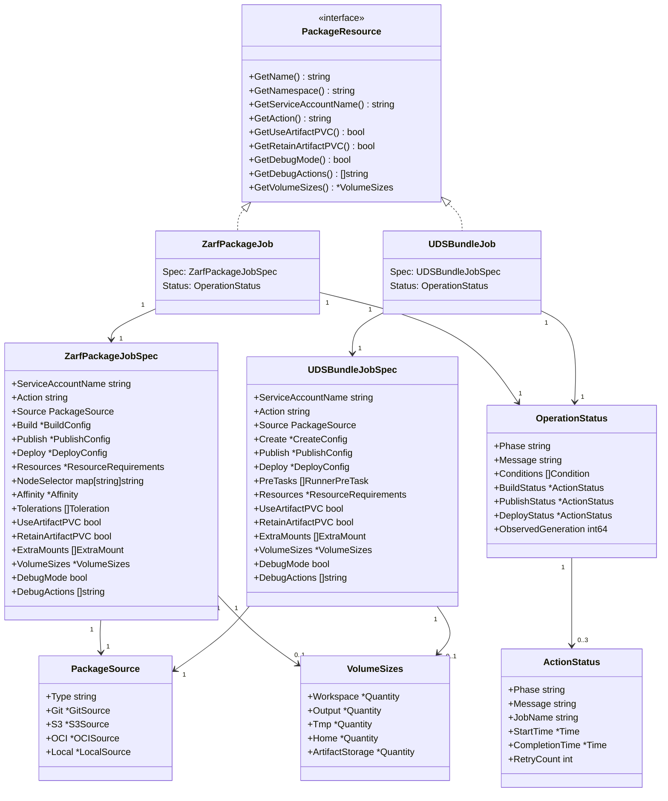
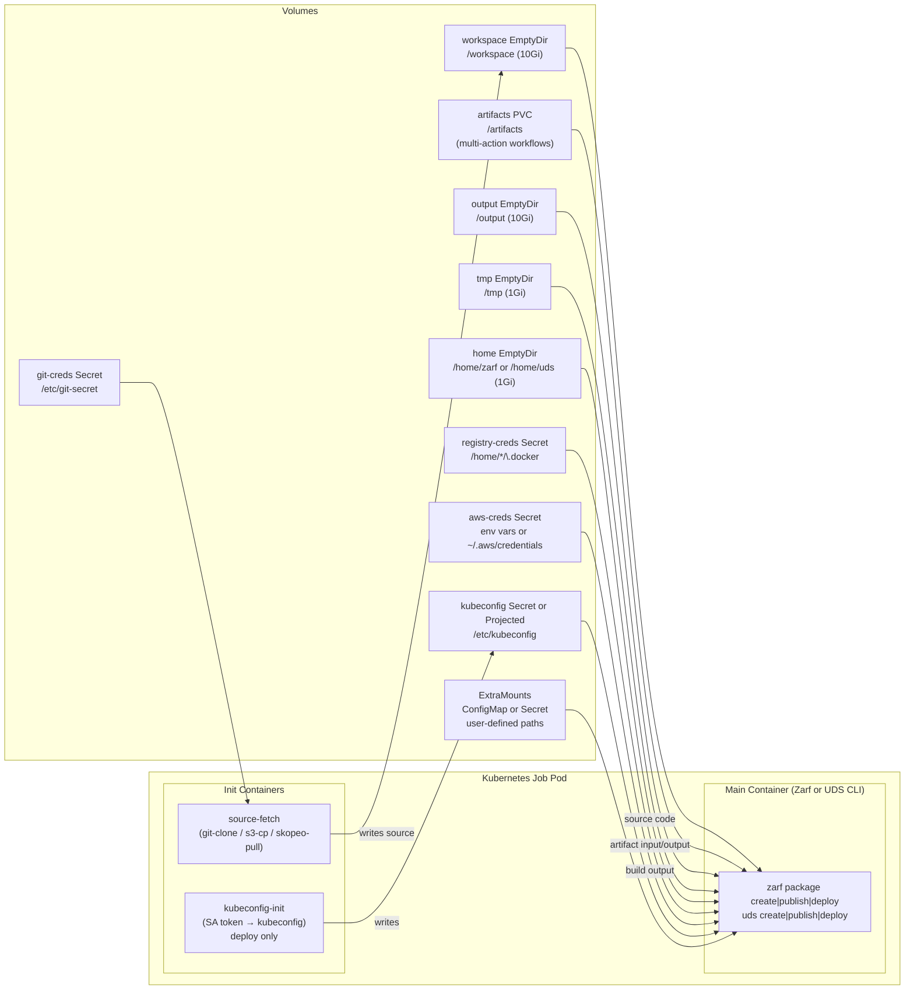
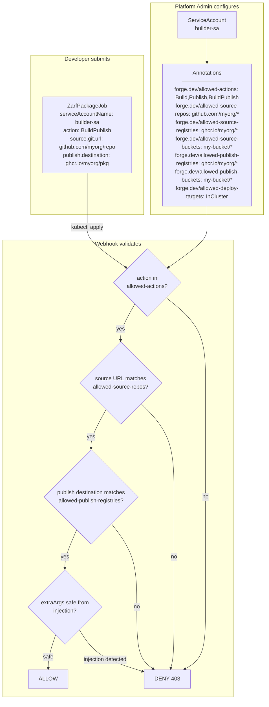
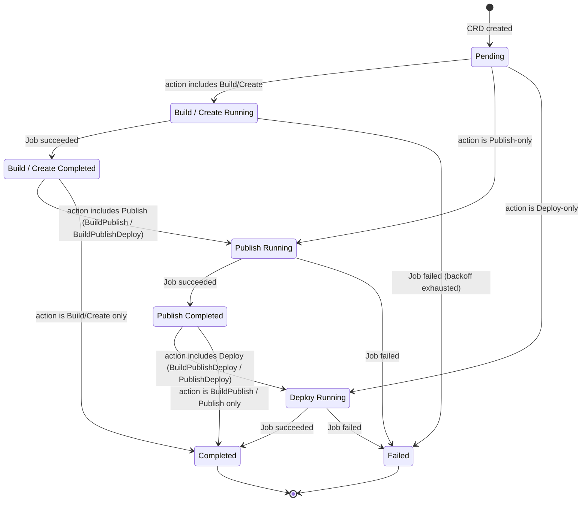
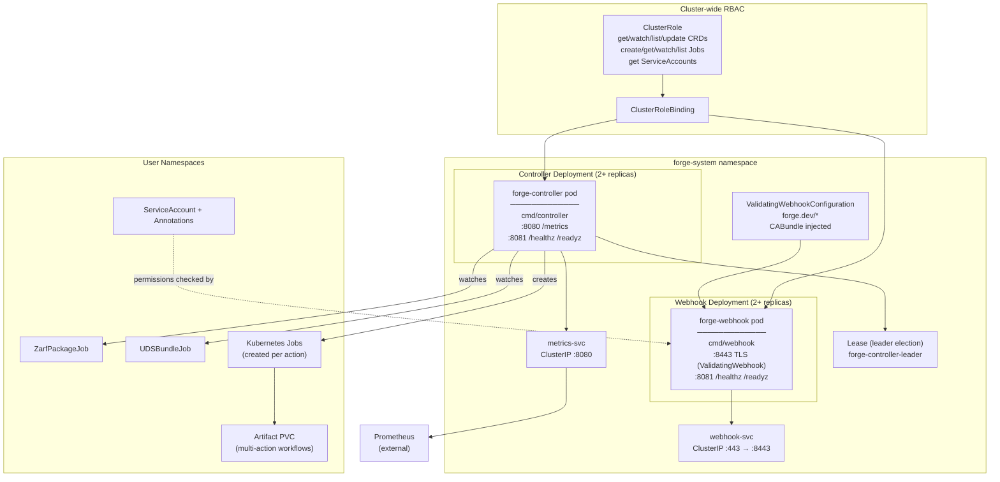

# Forge Architecture

## Overview

Forge is a Kubernetes operator that manages `ZarfPackageJob` and `UDSBundleJob` CRDs. When a user creates one of these resources, Forge validates it, builds Kubernetes Jobs to execute the requested operations (Build/Create → Publish → Deploy), monitors those jobs, and updates the CRD status with results.

---

## System Context



---

## Container Diagram



---

## Component Diagram



---

## End-to-End Request Flow



---

## CRD Type Hierarchy



---

## Job Volume Layout



---

## Webhook Permission Model



---

## Source and Destination Plugin Matrix

```mermaid
graph LR
    subgraph "Sources (pkg/sources)"
        GIT2["GitSource<br/>─────────<br/>SSH key<br/>Token/password<br/>OAuth<br/>Custom hosts"]
        S3SRC["S3Source<br/>─────────<br/>AWS IAM (EnvVar/File/Node)<br/>MinIO compatible<br/>Custom endpoint"]
        OCISRC["OCISource<br/>─────────<br/>Registry credentials<br/>skopeo pull"]
        LOCSRC["LocalSource<br/>─────────<br/>hostPath mount<br/>dev mode only"]
    end

    subgraph "JobBuilder"
        JB2["WithInitContainers()"]
    end

    subgraph "Destinations (pkg/destinations)"
        S3DST["S3Destination<br/>─────────<br/>publish oci://s3://…<br/>AWS creds: EnvVar/File/Node"]
        OCIDST["OCIDestination<br/>─────────<br/>publish oci://registry/…<br/>Docker config secret"]
        LOCDST["LocalDestination<br/>─────────<br/>publish tarball://…<br/>ephemeral storage"]
    end

    GIT2 -->|GetInitContainer()| JB2
    S3SRC -->|GetInitContainer()| JB2
    OCISRC -->|GetInitContainer()| JB2
    LOCSRC -->|GetInitContainer()| JB2

    JB2 --> S3DST
    JB2 --> OCIDST
    JB2 --> LOCDST
```

---

## Action Chain State Machine



---

## Deployment Architecture (Helm Chart)


